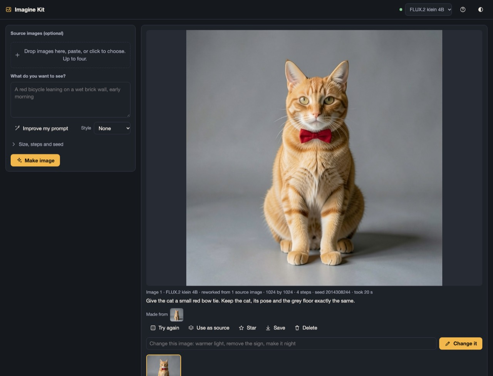

# Imagine Kit

Browser app and CLI for generating and editing images: text to image, edit one image, combine up to four, or edit a marked region. Local engines for Apple Silicon and NVIDIA; Google and OpenAI image models with your own key; or render on another machine.



## Requirements

| Machine | Local render | Time per image | Path |
|---|---|---|---|
| Mac, M-series, 24 GB+ RAM | yes | 10 to 30 s | Mac |
| Mac, M-series, 16 GB RAM | yes, 4-bit model | untested | Mac |
| Linux/WSL, NVIDIA 20 GB+ VRAM | yes, full precision | untested | Linux |
| Linux/WSL, NVIDIA 12 to 19 GB VRAM | yes, 4-bit model | 90 to 150 s | Linux |
| NVIDIA under 12 GB VRAM | no | | cloud model or remote |
| No NVIDIA GPU, Intel Mac | no | | cloud model or remote |

- On Linux and Windows the limit is VRAM, not system RAM. An RTX 3050 (8 GB, some 6 GB) cannot render locally.
- 12 GB floor: measured on a 16 GB card with the 4-bit model, a new image peaks at 7 GB and an edit at 9 to 13 GB.
- Disk: 16 GB for the default model, plus 5 GB for the NVIDIA engine.

## Install

```bash
git clone https://github.com/alcatraz627/local-models
cd local-models/imagine-kit
./install.sh        # --yes downloads the model without asking, --no-model skips it
./imagine           # serves the app on http://127.0.0.1:7717/
./imagine doctor    # what this machine can run, and what is missing
```

| Platform | Prerequisites | Notes |
|---|---|---|
| Mac | M1 or newer; `brew install uv` if Python 3.12 is missing | Installs mflux; asks before the model download |
| Linux | `sudo apt install python3 python3-venv git`; NVIDIA driver (`nvidia-smi` works) | Installs PyTorch and diffusers only if VRAM is 12 GB+; then `./imagine download klein` |
| Windows | WSL with Ubuntu; see "Windows, step by step" below | Untested on a real Windows machine |

With no usable GPU, `install.sh` installs the app only and skips the engine and model.

### Windows, step by step

Untested. The steps inside Ubuntu are the Linux path, which was run on Ubuntu 24.04 with a 16 GB NVIDIA card.

| Step | Where | Command or action |
|---|---|---|
| 1 | Windows | Install the current NVIDIA driver from nvidia.com. Skip this with no NVIDIA card; the app then draws through Gemini, GPT or another machine |
| 2 | PowerShell, as administrator | `wsl --install`, then restart Windows |
| 3 | Ubuntu (opens after the restart) | Choose a user name and password when asked |
| 4 | Ubuntu | `nvidia-smi` should list the card. Do not install an NVIDIA driver inside Ubuntu; WSL uses the Windows one |
| 5 | Ubuntu | `sudo apt update && sudo apt install -y python3 python3-venv git` |
| 6 | Ubuntu | `cd ~ && git clone https://github.com/alcatraz627/local-models && cd local-models/imagine-kit` |
| 7 | Ubuntu | `./install.sh`, then `./imagine` |
| 8 | Windows browser | Open `http://127.0.0.1:7717/` |

| If | Then |
|---|---|
| `nvidia-smi` is not found in Ubuntu | The Windows driver is missing or old. Redo step 1, run `wsl --shutdown` in PowerShell, open Ubuntu again |
| The render is killed part way | WSL gives Ubuntu half of the computer's memory by default. Put `[wsl2]` and `memory=24GB` in `C:\Users\<you>\.wslconfig`, then `wsl --shutdown` |
| Everything is slow to start | The kit is under `/mnt/c`. Keep it in the Ubuntu home folder, as in step 6 |
| The browser cannot reach the page | Leave the Ubuntu window that runs `./imagine` open, and use `127.0.0.1`, not the Ubuntu address |

## Without a local engine

| Option | Setup | Cost and data |
|---|---|---|
| Gemini image | Pick it in the model menu, paste a key from https://aistudio.google.com/apikey | Billed per image to the key's owner; prompt and source images go to Google |
| GPT image | Pick it in the model menu, paste a key from https://platform.openai.com/api-keys | Same, to OpenAI. Not yet run against the live API |
| Remote machine | Owner runs `lm net serve` and `lm net approve NAME`; you run `./imagine server add NAME ADDRESS` | Prompt and source images go to that machine; needs network reach (LAN or Tailscale) |

Keys: `GEMINI_API_KEY`, `OPENAI_API_KEY`, or the app's key box (stored in `data/keys.json`, mode 600). A remote machine appears under **Runs on**.

## App

| Control | Effect |
|---|---|
| Threads (left) | One per idea; holds every image derived from it. New thread, Rename |
| Source images | Up to four, by drop, paste or file; earlier uploads are listed below the box |
| Rework them / Start loosely | Instruction edit, or img2img with a strength slider (Start loosely is Mac only) |
| Tries | 1 to 4 seeds per request |
| Queue | Requests run one at a time; each can be stopped; limit 12 |
| Try again, 3 more tries | Same request, new seed |
| Change it | Edit the shown image from an instruction |
| Same start, new words | Same seed and sources, prompt extended |
| Mark an area | Drag a box; the edit is confined to it. Works on any image in the thread and on source images |
| Compare | Toggle between the image and its first source |
| Check | Percent of pixels changed, inside and outside a marked area; no model involved |
| Use as source, Star, Save, Delete | Delete moves files to `data/trash/` |
| Improve my prompt | Rewrites via a local Ollama model if one is running, else a template; has undo |

Marked area: the region plus a 25% margin is cropped, edited alone, and blended back. Pixels outside the crop are untouched. Effects that should extend past the box (glow, shadow) are clipped at its edge.

Edit instructions: state the change, where, and what stays. One change per instruction. See [PROMPTING.md](PROMPTING.md).

## Models

| Id | Model | Runs | Edit | Size | Notes |
|---|---|---|---|---|---|
| `klein` | FLUX.2 klein 4B | local | yes | 16 GB | Default, 4 steps |
| `qwen` | Qwen-Image | local, Mac only | no | 50 GB | 64 GB RAM; best at text in images |
| `gemini` | Gemini image | Google | yes | | Model id is discovered from the API; override with `IMAGINE_KIT_GEMINI_MODEL` |
| `gpt` | GPT image | OpenAI | yes | | Override with `IMAGINE_KIT_OPENAI_MODEL` |

## CLI

```bash
./imagine gen "a red bicycle in the rain"
./imagine gen "make the jacket red" --from photo.jpg
./imagine gen "put the cup on the desk" --from cup.png --from desk.png
./imagine gen "make it night" --from photo.jpg --model gemini
./imagine rework 12 "warmer light"
./imagine rework 12 "make the sign blue" --area 0.5,0.1,0.3,0.2
./imagine again 12
./imagine check 13
./imagine history
./imagine models
./imagine help
```

`--json` prints the record, or the error, as JSON. Agent usage: [AGENTS.md](AGENTS.md).

## Data

| Path | Contents |
|---|---|
| `data/images/` | Outputs, each with `NAME.metadata.json` |
| `data/sources/` | Source images, content-addressed |
| `data/history.jsonl` | One record per image |
| `data/threads.json` | Thread names |
| `data/trash/` | Deleted images |
| `data/keys.json` | Saved API keys |
| `~/.cache/huggingface` | Local model weights |

`IMAGINE_KIT_DATA` relocates `data/`.

## Errors

| Message | Cause | Fix |
|---|---|---|
| cannot run on this computer | VRAM under 12 GB, or no supported GPU | Cloud model or remote machine |
| needs a key from | Cloud model without a key | Paste a key in the app |
| did not accept the key | Bad key, or billing off | New key; enable billing |
| The image engine is not installed | `install.sh` did not finish | `./install.sh` |
| is not downloaded yet | Model missing or partial | `./imagine download klein` |
| stopped before it finished, most likely for memory | Out of memory | Smaller size; close other apps |
| waiting for approval | Remote owner has not approved this device | Owner runs `lm net approve NAME` |
| The kit is not running | Server process ended | `./imagine` |

## Tested (2026-11-20)

| Setup | Result |
|---|---|
| Mac M5 Pro, 64 GB | Clean install; new 11 s, edit 19 s, two-source 30 s, marked area 18 s |
| Ubuntu 24.04, NVIDIA T4 16 GB | Clean install; new 93 s, edit 150 s, two-source 120 s (4-bit) |
| Gemini image | Edit in 6 s |
| Remote render | Loopback only, one Mac |

Untested: Windows, 16 GB Mac, NVIDIA 20 GB+, GPT image, remote render between two machines.

## Built on

[mflux](https://github.com/filipstrand/mflux) (Apple Silicon), [diffusers](https://github.com/huggingface/diffusers) (NVIDIA). FLUX.2 klein 4B by Black Forest Labs and Qwen-Image by Alibaba, both Apache 2.0. Code: `kit.py`, `app.html`, `engine_diffusers.py`; tests in `tests/test_kit.py` run without a model.
